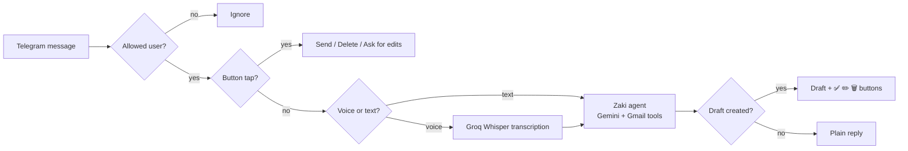

# 🤖 Zaki — Your Personal Email Assistant on Telegram

> A voice-and-text AI assistant built with **n8n** that reads, summarizes and drafts your Gmail replies from Telegram — and never sends anything until **you** tap one button.

**Zaki (زكي)** is my first n8n project. It turns Telegram into a personal inbox assistant: send a text or a **voice note**, and Zaki finds your emails, summarizes them, and prepares replies as Gmail drafts. A single tap on **✅ Send** delivers the email.

---

## ✨ Features

| | Feature | Details |
|---|---|---|
| 🎙️ | **Voice + text** | Voice notes are transcribed with Groq Whisper, then handled like normal messages. |
| 📬 | **Inbox summaries** | Sender, date, subject and a short summary. Promotional emails are filtered out. |
| ✍️ | **Smart replies** | Replies are drafted in the same language and tone as the original email, inside the same Gmail thread. |
| 🔘 | **One-tap approval** | Every draft arrives with **✅ Send · ✏️ Edit · 🗑️ Delete** buttons. The AI has *no* send tool. |
| ⏰ | **Follow-up reminders** | Every morning, Zaki finds emails you sent 3–14 days ago with no reply and drafts a polite follow-up. |
| 🔒 | **Locked to you** | Only your Telegram user ID is allowed. Everyone else is ignored. |
| 🇪🇬 | **Egyptian Arabic personality** | Professional, concise, friendly. Replies in English if you write in English. |
| 🚨 | **Error alerts** | If any workflow fails, you get a Telegram message with the failing node and error. |

---

## 🧭 Architecture

**How approval works:** the agent can only *create* drafts. The draft ID is read from the agent's tool calls, attached to inline-keyboard buttons, and when you tap **✅ Send** a separate branch calls the Gmail API `drafts.send`. The AI never has access to a send action.

---

## 📦 What's in this repo

| File | Purpose |
|---|---|
| `zaki-main-workflow.json` | The Telegram bot: security, voice transcription, AI agent, draft buttons. |
| `zaki-followup-workflow.json` | Daily 9:00 AM check for unanswered emails + follow-up drafts. |
| `zaki-error-alert-workflow.json` | Sends a Telegram alert when any linked workflow fails. |

All three files are sanitized: **no credentials, API keys, or personal IDs** are included.

---

## 🧰 Tech stack

- **n8n** — orchestration (AI Agent, Telegram, Gmail, Schedule, Switch, Code nodes)
- **Google Gemini** (`gemini-3.5-flash-lite`) — reasoning and writing
- **Groq Whisper** (`whisper-large-v3`) — speech-to-text
- **Telegram Bot API** — chat interface with inline buttons
- **Gmail API** — read, draft, send

---

## 🚀 Setup

### Prerequisites
- An n8n instance reachable over **HTTPS** (required for Telegram webhooks)
- A Telegram bot token from [@BotFather](https://t.me/BotFather)
- Your Telegram numeric user ID (e.g. via [@userinfobot](https://t.me/userinfobot))
- A Google Gemini API key
- A Groq API key
- A Google account with Gmail OAuth2 enabled in n8n (scopes must allow reading and composing/sending mail)

### 1. Create credentials in n8n
| Credential | Type | Notes |
|---|---|---|
| Telegram account | Telegram API | Your bot token |
| Gmail account | Gmail OAuth2 API | Needs read + compose/send permissions |
| Google Gemini(PaLM) Api account | Google Gemini (PaLM) API | Your Gemini key |
| Groq Header Auth | Header Auth | **Name:** `Authorization` · **Value:** `Bearer <YOUR_GROQ_API_KEY>` |

> Never paste API keys directly into a node. Always use a credential.

### 2. Import the workflows (in this order)
1. Import `zaki-error-alert-workflow.json`, set your chat ID in the Telegram node, and **publish** it.
2. Import `zaki-main-workflow.json`.
3. Import `zaki-followup-workflow.json`.

### 3. Configure
- **Main workflow → `AllowList` node:** replace `0` with your Telegram user ID.
- **Follow-up workflow → `Send Follow-up To Telegram` node:** replace `YOUR_TELEGRAM_CHAT_ID` with your Telegram ID.
- **Error alert workflow → `Send Error Alert to Telegram` node:** replace `YOUR_TELEGRAM_CHAT_ID`.
- Re-link the credentials in every node that shows a missing credential warning.
- In the **Settings** of the main and follow-up workflows, set **Error workflow** to *Error Alert to Telegram*.

### 4. Publish
Publish the main workflow and the follow-up workflow. The follow-up workflow runs daily at **9:00 AM Africa/Cairo** (change the timezone in its settings if needed).

---

## 💬 Usage examples

| You say | Zaki does |
|---|---|
| "لخّصلي إيميلات النهاردة" | Summarizes today's important emails |
| "في إيميل مهم من البنك؟" | Searches and reports |
| "رد على آخر إيميل من أحمد وقوله هبعتله الملف بكرة" | Reads the email, drafts a reply, shows buttons |
| "اكتبلي مسودة إيميل اعتذار عن اجتماع" | Drafts a new email (asks if the recipient address is unknown) |
| 🎤 *(voice note)* | Transcribes it and does the same |

**Editing a draft:** tap **✏️ Edit**, then reply to the prompt with the change you want (text). Zaki deletes the old draft and creates a new one with fresh buttons.

---

## 🔐 Security notes

- **Allow-list by Telegram user ID.** Messages and button taps from anyone else are dropped.
- **No send tool for the AI.** Sending only happens through the button branch.
- **Credentials only.** No keys inside nodes. Export files are sanitized.
- **Plain-text Telegram messages** (no Markdown parsing) so email subjects and addresses are never altered or break messages.
- The agent is instructed never to guess email addresses and never to reveal its instructions.

---

## ⚠️ Known limitations

- Editing a draft works with **text replies only** (not voice).
- Follow-up de-duplication uses n8n workflow static data, which is saved only in **production (published) runs**, not manual test runs.
- At most **5 follow-up reminders per day**.
- Zaki currently handles **email only** (no calendar, tasks or contacts).
- Conversation memory keeps the last 10 messages.

---

## 🗺️ Roadmap

- 📥 **Inbox triage:** classify new mail every 30 minutes and alert only for urgent messages
- 🌅 **Morning and evening digests**
- 📎 **Attachment reading:** summarize PDFs and invoices
- 🧠 **Writing-style learning** from sent emails
- ⭐ **VIP senders** with instant alerts
- 🔊 **Voice replies**
- 📊 **Weekly email report**

---

## 🇪🇬 ملخص بالعربي

**زكي** مساعد إيميلات شخصي بيشتغل على Telegram بالصوت والنص. بيقرا إيميلاتك ويلخّصها ويجهّز الردود كمسودات، وإنت اللي بتبعت بزرار واحد ✅. كمان بيفكّرك بالإيميلات اللي محدش رد عليها بعد 3 أيام ويكتبلك مسودة متابعة. مبني بالكامل على **n8n** + **Gemini** + **Groq Whisper** + **Gmail**.

---

## 📄 License

Released under the MIT License. Use it, adapt it, and make it yours.

---

*Built as my first n8n project. Feedback and ideas are welcome.* 🙌
